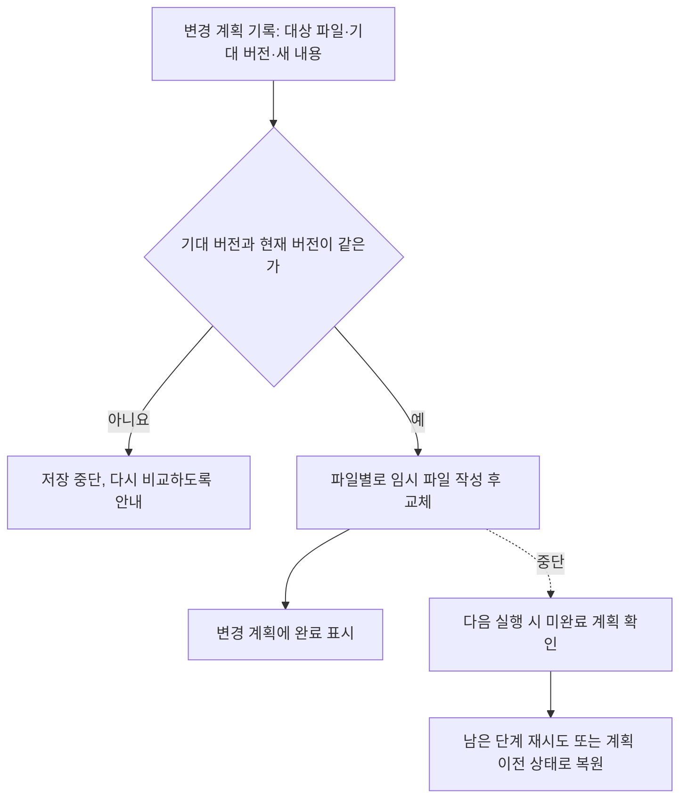

# Study 고도화 — LearnHarness 체계 도입 설계

## 목차

- [문서 상태](#문서-상태)
- [한 문단 요약](#한-문단-요약)
- [범위](#범위)
- [1. 학습 흐름](#1-학습-흐름)
- [2. 지식 모델](#2-지식-모델)
- [3. 학습 근거](#3-학습-근거)
- [4. 자동 반영과 교재](#4-자동-반영과-교재)
- [5. 통합 복습](#5-통합-복습)
- [6. 저장소 구조](#6-저장소-구조)
- [7. 저장·복구](#7-저장복구)
- [8. 다른 PC와 쓰기 범위](#8-다른-pc와-쓰기-범위)
- [9. 화면](#9-화면)
- [10. 구성 요소](#10-구성-요소)
- [11. 실패 처리](#11-실패-처리)
- [12. 기존 기록 이전](#12-기존-기록-이전)
- [13. 검증](#13-검증)
- [14. 도입 순서](#14-도입-순서)
- [구현 계획에서 정할 것](#구현-계획에서-정할-것)
- [참고 문서](#참고-문서)

## 문서 상태

- **상태:** 사용자 승인 설계. 2026-10-30 “진행해”로 저장·복구·이전 추천안까지 승인
- **승인 범위:** 설계 내용. 구현 시작·실제 study 데이터 이전·커밋·푸시는 별도 승인 필요
- **대상 코드:** `runtime/pi/extensions/study/`, 관련 지침·프롬프트, `resources/skills/tool/study-dialogue/`
- **대상 학습 저장소:** 현재 PC 기준 `/Users/jimmylee/IdeaProjects/study`. 경로 자체는 계약이 아님
- **LearnHarness:** 커밋 `3dd52110bbcbcba81645453ce0a8fdc230594c47`의 정적 소스 분석에서 아이디어만 참고. 소스·프롬프트 복사 없음
- 상세 근거와 결정 경위는 [decisions.md](learnharness-study/decisions.md)

## 한 문단 요약

배운 내용은 study 루트의 **공통 노트**에 한 번만 저장하고, 각 프로젝트 교재는 그 설명에 자기 예시를 붙여 사용한다. 저장 단위는 큰 제목이 아니라 **조건이 붙은 구체적인 주장(명제)** 이다. 공통 노트는 에이전트가 자동으로 고치되 이력을 남기고, 근거가 부족한 내용은 정답으로 쓰지 않는다. 내가 실제로 한 답은 **별도의 공부 기록**으로 남기며, 복습은 기억할 내용마다 하나의 일정으로 `+1 / +3 / +7 / +14일` 간격으로 진행한다. 진단과 개념 학습은 Pi 대화로, 완료 시험은 기존 HTML로 진행한다.

## 범위

**포함**

- 대화형 진단과 개념 학습, 과제별 도움 수준을 고르는 실습
- 루트 공통 지식, 관계, 출처, 버전, 자동 반영
- 교재 README의 공통 관리 영역 자동 최신화
- 지식별 통합 복습과 기존 챕터 복습 이전
- 루트 탐색, PC 간 이식성, 저장 중단 복구
- 작은 상태 위젯과 필요할 때 여는 지도

**제외**

- 새 음성 인식, 모델·계정·비용 관리
- 기존 `study-*` 폴더 이동, `projects/` 재배치
- 우측 고정 패널·터미널 분할
- 기억 확률 모델·자동 간격 최적화
- 시각적 그래프 편집기
- 자동 커밋·푸시

## 1. 학습 흐름

```text
입력 → 커리큘럼 승인 → 진단 → 개념 학습 → 프로젝트 실습 → HTML 완료 시험 → 통합 복습
```

### 입력

- 주제 문자열, 사용자 지정 파일·디렉터리·URL
- 읽은 자료와 읽지 못한 자료를 구분해 기록
- 커리큘럼 브라우저 미리보기와 승인 흐름 유지

### 진단 — Pi 대화

- 한 번에 하나씩 질문. 객관식·자유 응답 선택
- **학습 경로를 정할 수 있으면 종료.** 기본 상한 8문항이며 최소 문항 수 없음
- 상한은 진단 시도 단위. 세션 재개로 초기화하지 않음
- 설명 요청·중단·건너뛰기 허용. 미확인은 이해 완료로 처리하지 않음
- 종료 사유 기록: 경로 결정, 상한 도달, 사용자 요청
- 기존 HTML 진단은 과거 기록으로 보존. 새 진단은 대화형만 사용

### 개념 학습

```text
짧은 설명 → 필요하면 결과 예측 → 원리·조건 설명 → 자기 말 설명 또는 변형 확인 → 보충 또는 다음
```

- 예측 질문은 학습 전 생각 확인. 틀려도 감점 아님
- 확인 질문은 설명 후 이해 확인
- 모든 문장 뒤 질문 강제 금지. 확신도는 선택 수집
- 개념 학습을 마친 뒤 프로젝트 실습 시작

### 실습

| 상황 | 도움 수준 |
|---|---|
| 구조 자체가 낯섦 | 완성 예제 분석 |
| 원리는 알지만 조건 변화 적용이 어려움 | 기존 예제의 작은 수정 |
| 토대와 관련 근거가 있음 | 독립 구현 |

- 에이전트가 과제별로 선택하고 이유를 짧게 설명. 사용자 변경 가능
- 기존 `lab.mode`(cli/application/document/mixed)는 산출물 유형이며 도움 수준과 다른 축
- `study_preflight`, manifest, `study_lab_verify` 유지
- 학습자가 직접 관찰한 결과와 배운 점 필수. 에이전트 작성 코드의 통과를 독립 수행으로 기록 금지

### 완료 시험

- 기존 `study_test_open` HTML 제출·채점·결과 확인 흐름 유지
- 미달이면 부족한 부분만 보충 후 새 시도

### 진단 담당과 수업 담당

- 역할별 지침과 입출력 계약 분리. 별도 에이전트 프로세스는 요구하지 않음
- 교사의 설명을 학습자 응답으로 기록 금지

## 2. 지식 모델

### 기본 단위 — 명제

- 저장·재사용·동일성 판단의 기준은 **주장 + 조건 + 범위**
- 짧은 이름은 표시용. 큰 개념은 이름·태그·목록으로 탐색. 별도 Concept 원본 계층 없음
- 독립적으로 참조·검증·질문·수정할 주장만 분리
- 재사용할 정의·규칙·판단 기준은 논증 연결이 없어도 보존
- 풀이·비유·숫자 예시·일회성 실행 결과는 관련 설명이나 프로젝트 기록에 보관

### 관계

| 관계 | 의미 | 주의 |
|---|---|---|
| 추론 | 전제 묶음이 함께 맞으면 결론이 맞음 | 공동 전제를 독립 화살표로 분해 금지. 같은 결론의 다른 논증은 별도 사슬 |
| 선수 학습 | 이번 목표를 위해 먼저 배울 순서 | 목표·학습자별 경로. 건너뛰어도 논리적 전제는 남음 |
| 적용 맥락 | 이 내용을 쓰는 프로젝트·챕터 | 이해 완료의 증거 아님 |

### 수집과 사용 경계

- 후보 입력: 지정 자료, 학습 교재, 교사 설명, 자료로 지정한 개인 노트
- 출처·조건·범위 확인. 원문 명시·해석·가설 구분
- 근거 부족 후보는 **미확정**으로 보존. 확정 교재·정답 기준으로 사용 금지
- 학습자 답변은 공통 지식으로 자동 승격하지 않음
- 근거 없는 추론 사슬 생성 금지
- 출처나 자동 검토 통과를 참의 보증으로 간주하지 않음

### 동일성과 수정

| 경우 | 처리 |
|---|---|
| 같은 뜻·같은 조건 | 기존 ID에 표현·출처 추가 |
| 같은 지식의 오류 교정·정밀화 | 새 버전. 이전 내용·이유 보존 |
| 조건·범위가 다름, 또는 판단이 모호 | 별도 ID 또는 후보 |

- 이름 유사도만으로 병합 금지
- 과거 답안은 당시 버전에 연결
- 잘못된 병합 해제 시 이전 ID·출처·근거 연결 복구. 무관한 기록은 유지

## 3. 학습 근거

- 원 응답, 질문, 당시 정답 기준, 힌트·교정, 판정 이유, 확신도, 시점, 맥락, 지식 버전 기록
- **최초 응답 덮어쓰기 금지.** 교정·재평가는 추가 기록
- 실제 확인한 명제에만 연결. 질문 하나가 여러 명제를 다루면 명제별로 판정
- 전제를 각각 아는 것과 전체 추론을 독립 수행한 것은 별도 확인
- 독립 회상, 힌트 후 응답, 교정 직후 확인, 학습 직후 확인을 구분
- 미응답·도움 여부 불명·실행 미확인은 추측하지 않고 미확인 표시
- 원 응답은 발생한 위치에 보존: 프로젝트(진단·실습·시험) 또는 루트 `review/sessions/`

### 출제 전 답안 확정

- 채점 질문은 제시 전에 정답·허용 대안·채점 기준·근거 버전 저장
- 비채점 질문은 비채점으로 명시
- 답변 전 화면·payload·위젯·지도에 정답 노출 금지
- 문항 오류는 최초 기준과 정정 사유를 보존하고 재출제 또는 명시적 재평가

## 4. 자동 반영과 교재

### 반영 절차

1. 자료·교재·교사 설명에서 후보 구성, 근거 상태 확인
2. 기존 지식과 비교: 재사용·표현 추가·새 버전·별도 ID
3. 변경 계획을 먼저 기록 — [7. 저장·복구](#7-저장복구)
4. 공통 지식 반영, 이력 추가
5. 영향 받는 교재 관리 영역 갱신, 지도·복습 연결 갱신
6. 학습 구간이 끝날 때 변경 요약 제공. 사용자는 사후 수정·되돌리기 가능

- 매 변경의 사전 승인 단계 없음

### 교재 관리 영역

```markdown
<!-- study:knowledge k-7f3a9c v2 hash=1a2b3c -->
공통 설명 본문
<!-- /study:knowledge -->
```

| 상황 | 처리 |
|---|---|
| 현재 본문 지문 = 기록된 지문 | 새 버전으로 교체 |
| 지문 다름 — 사용자가 직접 수정 | **덮어쓰지 않고 보류**, 차이 안내 |
| 표시 손상 | 자동 수정 없이 안내 |
| 표시 밖 | 개인 메모·프로젝트 예시. 수정 금지 |

- 보류 해결: 새 설명 적용 / 직접 수정본 유지 / 직접 수정 내용을 공통 지식에 반영
- 공통 설명 변경으로 프로젝트 예시가 부정확해질 수 있으면 재검토 표시
- 교재는 명제 목록이 아니라 설명 흐름·예시·맥락으로 구성

## 5. 통합 복습

### 일정 규칙

| 항목 | 규칙 |
|---|---|
| 단위 | 명제 ID마다 일정 하나. 프로젝트·챕터는 범위 필터 |
| 간격 | **`+1 / +3 / +7 / +14일`** |
| 최초 기준일 | **챕터를 끝낸 날** — 완료 시험 통과일. 시험을 건너뛰었다면 챕터 완료 처리일 |
| 종료 | 마지막 회차를 실제로 마치면 끝. 자동 연장 없음 |
| 오답 | 틀린 날부터 가장 짧은 간격으로 다시 |
| 힌트 후 정답 | 오답과 같이 처음 간격부터. 기록에는 “힌트 후 정답” |
| 늦은 복습 | 다음 날짜는 실제로 복습한 날부터 계산 |
| 시간대 | 루트 설정. 기본값 `Asia/Seoul` |
| 하루 양 | **제한 없음.** 원할 때 중단, 남은 항목은 미완료로 유지하고 날짜 변경 없음 |
| 미래 회차 | 미리 당겨 수행하지 않음 |
| 다른 맥락에서 재등장 | 그 사실만으로 일정 이동·초기화·완료 없음 |

### 진행

- 연관 명제를 한 질문으로 묶을 수 있음. 판정은 명제별
- 독립 응답 → 판정 → 필요한 보충 → 교정 확인 순서
- STRONG 등은 해당 응답의 평가이며 장기 기억 인증이 아님
- 본 학습에서 다루지 않은 내용은 학습 공백으로 분리. 복습 오답으로 기록 금지
- 공통 지식이 실질적으로 바뀐 경우 해당 부분 확인 필요 표시

## 6. 저장소 구조

```text
study/
├── .study/
│   ├── workspace.json       # 루트 표시, 시간대·복습 간격 등 공통 설정
│   └── local/               # PC 전용. .gitignore
│       ├── sources.json     # 외부 자료 위치 매핑
│       ├── pending/         # 진행 중인 변경 계획
│       ├── locks/
│       └── cache/           # 지도·검색 색인. 삭제 후 재생성 가능
├── knowledge/
│   ├── items/k-xxxxxx.md    # 명제 하나당 파일 하나. 최신 내용
│   ├── chains.jsonl         # 전제 묶음 → 결론
│   └── history/k-xxxxxx.jsonl  # 버전별 전체 내용·이유. 추가만 함
├── review/
│   ├── items/k-xxxxxx.json  # 명제 하나당 일정 하나
│   └── sessions/            # 복습 질문·원 응답·판정. 추가만 함
├── backlog/
└── study-*/                 # 기존 위치 유지
    └── .study/project.json  # 프로젝트 ID 포함. 없는 레거시는 등록 시 생성
```

- **명제마다 파일을 나누는 이유:** PC 간 Git 충돌 축소, 손상 범위 국한, 사람이 읽기 쉬움
- 설명은 Markdown, 관계·ID·버전·일정은 구조화 데이터
- 같은 내용을 두 곳에 원본으로 두지 않음. 색인은 재생성 가능
- 프로젝트 쪽 지식 연결은 `project.json` 또는 챕터 메타데이터에 지식 ID·참조 버전으로 기록

### ID와 버전

- 지식 ID: 경로·문장과 무관한 무작위 식별자. 예: `k-7f3a9c`
- 버전: 지식별 증가 번호. 참조 형식 예: `k-7f3a9c@v2`
- 병합: 흡수된 ID 파일을 지우지 않고 `mergedInto` 표시. 조회 시 대상으로 안내
- 병합 해제: 표시 제거로 복원. 학습 근거는 원래 ID 그대로

## 7. 저장·복구

여러 파일을 함께 바꾸는 작업은 **변경 계획 → 적용 → 완료 표시** 순서로 진행한다.



- 변경 계획 위치: `.study/local/pending/`. 이전 내용 포함으로 복원 가능
- 파일 쓰기: 임시 파일에 완전히 쓴 뒤 rename. 반쯤 쓰인 파일 방지
- 낙관적 동시성: 저장 직전 버전·지문 비교. 다른 세션 변경을 덮어쓰지 않음
- 같은 PC 동시 실행: 잠금 파일. 오래된 잠금은 프로세스 확인 후 해제
- 학습 근거·phase 저장 실패는 실패로 보고. 성공처럼 표시 금지
- 버전 이력은 Git 커밋 여부와 무관하게 보존

## 8. 다른 PC와 쓰기 범위

### 루트 탐색

1. 현재 디렉터리에서 상위로 `.study/workspace.json` 탐색
2. 없으면 명시적으로 지정한 경로
3. 그래도 없으면 안내. 홈 전체 탐색·새 루트 자동 생성 금지
4. 후보가 여럿이거나 표시가 손상되면 선택·복구 안내

- 기존 `findStudyProjectRoot`의 프로젝트 탐색은 루트 탐색과 별개로 유지

### 경로

- 프로젝트 위치는 루트 기준 상대 경로
- 기존 `state.json`의 절대 `projectRoot`는 호환용으로만 읽음. 실제 위치는 현재 루트에서 계산
- 과거 기록 안의 경로 문자열은 일괄 치환하지 않음
- 루트 밖 외부 자료는 자료 ID + `.study/local/sources.json` 매핑. 없으면 “자료 없음” 표시
- 외부 자료의 자동 대량 복사 금지

### 쓰기 범위

- 루트 공통 쓰기: `.study/`, `knowledge/`, `review/`만
- 프로젝트 쓰기: 기존 `projectPath` 검사 유지. 느슨하게 풀지 않음
- `..` 탈출·심볼릭 링크 경유 쓰기 차단

### Git

- 자동 커밋·푸시 없음. 기존 checkpoint 승인 절차 유지
- PC 간 충돌 후에는 검사 명령으로 깨진 ID·버전·연결 탐지

## 9. 화면

- **상태 위젯:** `ctx.ui.setWidget()`으로 현재 프로젝트·챕터·단계·지식·다음 행동 표시
- **지도:** 요청 시 현재 목표 주변부터 표시. 관계 종류 구분, 표 보기, 상세 보기
- 지도에서 선택한 항목은 학습 위치를 바꾸지 않음
- 최초 지도는 읽기 중심. 수정 요청은 Pi 대화로 전달
- 화면 표시 실패가 학습 진행·근거 저장을 막지 않음

## 10. 구성 요소

| 구성 요소 | 책임 | 위치 후보 |
|---|---|---|
| 워크스페이스 | 루트 탐색·등록, 상대 경로, 쓰기 범위 | `src/workspace/` 신규, `src/project/` 연계 |
| 지식 | ID·내용·조건·관계·출처·버전·병합 | `src/knowledge/` 신규 |
| 변경 적용 | 변경 계획·잠금·원자적 쓰기·복구 | `src/workspace/` 또는 공용 저장 모듈 |
| 학습 근거 | 원 응답·판정·도움·버전 연결 | assessment·lab·session 계약 확장 |
| 대화형 진단·수업 | 질문·종료·재개 | `src/session/`, phase 지침 |
| 교재 갱신 | 관리 영역 렌더·지문 비교·보류 | `src/knowledge/` 하위 |
| 통합 복습 | 일정 계산·대상 조회·기록·이전 | `src/review/` |
| 화면 | 위젯·지도 | Pi widget, 기존 browser bridge |

- `index.ts`는 등록과 조립만
- 순수 도메인 로직과 Pi·파일·브라우저 adapter 분리
- 대화형 진단과 HTML 시험의 다른 계약을 억지로 공통화하지 않음

## 11. 실패 처리

| 상황 | 처리 |
|---|---|
| 자료 접근 실패·출처 상충 | 범위 표시. 읽지 않은 자료로 주장 생성 금지 |
| 루트 불명·여러 후보 | 선택·복구 안내 |
| 진단 중단 | 질문 ID·원 응답·미확인 범위로 재개. 중복 평가 방지 |
| 지식 동시 수정 | 버전 불일치 시 저장 중단 |
| 반영 중 중단 | 변경 계획으로 재시도 또는 복원 |
| 교재 직접 수정 | 보류·차이 안내 |
| 잘못된 병합 | 해당 병합만 해제 |
| 실행 검증 실패 | 독립 수행으로 승격 금지 |
| 위젯·지도 실패 | 경고만. 저장된 근거·시험 결과 유지 |
| 근거·phase 저장 실패 | 실패로 보고. 재개 가능 상태 보존 |

**보안 경계**

- 자료·HTML·응답은 데이터. 지침으로 실행하거나 권한 확장 금지
- 브라우저 loopback·세션 식별·제출 검증 유지
- 렌더링 시 HTML·스크립트 삽입 방지

## 12. 기존 기록 이전

### 현재 상태 — 2026-10-30 읽기 전용 확인

| 프로젝트 | 상태 | 이전 처리 |
|---|---|---|
| `study-backend-optimization-practical-case` ch-01–05 | 끝낸 챕터 없음. 일정은 문구만 | 일정 없음. 챕터 완료 시 새 방식 |
| `study-thread-pool-from-scratch` ch-01–17 | 끝낸 챕터 없음. 빈 일정표 | 일정 없음 |
| `study-redis-read-through-lifecycle` ch-01, 02 | 시험 완료. 복습 시작 안 함 | **자동 시작 없음.** 원할 때 시작, 완료일 불확실 시 시작일 기준 |
| redis ch-03, ch-04 | 복습을 직접 건너뜀 | **건너뛴 선택 유지.** 일정 생성 없음 |
| redis ch-03 R1–R4 `planned` | 수행 기록 없음 | 완료로 변환 금지. 원본 보존 |

- 실제 복습 응답 기록 없음
- redis 일부 완료 시각이 `2026-08-18T07:06:17.22x`로 동일. 실제 완료일로 신뢰하지 않음
- `study-thread-pool-from-scratch/.study/state.json`에 커밋되지 않은 변경 존재

### 이전 절차

1. **미리 보기:** 생성·연결 계획 보고서만 출력. 파일 변경 없음
2. **사전 조건:** Git 작업 트리 정리 확인
3. **루트 등록:** `.study/workspace.json`, `.gitignore`에 `.study/local/` 추가, 레거시 `project.json` 보완
4. **지식 연결:** 사용자가 시작을 원한 챕터만 핵심 개념을 공통 지식으로 연결
5. **검사:** 연결·원본 불변 확인
6. **되돌리기:** 이번 이전에서 추가한 항목만 제거

- 기존 `review/` 파일·`state.json`은 지우거나 고치지 않음
- 하지 않은 복습의 완료 기록 생성 금지
- 실제 실행은 구현·검증 후 별도 승인

## 13. 검증

### 자동화 테스트 — 임시 fixture 사용

1. **학습 단계:** 진단 상한·조기 종료·재개 시 상한 유지, 개념 후 실습 순서, HTML 시험 흐름 유지
2. **평가:** 출제 전 기준 저장, 제출 전 정답 비노출, 문항 정정 시 원본 보존, 힌트·독립·교정 구분
3. **지식:** 조건이 다른 동명 지식 미병합, 공동 전제 보존, 과거 버전 조회, 병합 해제 복원
4. **교재:** 관리 영역만 갱신, 직접 수정 시 보류, 표시 밖 불변
5. **저장·복구:** 중간 강제 중단 후 재시도·복원, 동시 수정 거부, 잠금
6. **복습:** 간격 계산, 늦은 복습, 오답·힌트 후 재시작, 마지막 회차 후 종료, 미래 회차 거부, 같은 지식 중복 일정 없음
7. **이식성:** 다른 절대 경로로 복제 후 연결 유지, 루트 밖·심링크 쓰기 차단, 캐시 삭제 후 재생성
8. **이전:** 미리 보기의 무변경, 원본 불변, 미수행 회차 완료 변환 없음, 건너뛴 챕터 일정 미생성
9. **회귀:** 커리큘럼 승인, 시험 attempt·ack, preflight·lab, checkpoint Git 안전장치, 브라우저 수명 주기

### 실사용 파일럿

- 한 챕터로 진단 → 개념 → 실습 → 시험 → 통합 복습 연결 확인
- 다른 프로젝트에서 같은 지식 재사용 확인
- 질문 수·불필요한 중단·힌트 수준 관찰. 만족도·정답률만으로 장기 기억 향상 단정 금지

## 14. 도입 순서

1. **워크스페이스·저장 기반:** 루트 탐색·등록, 상대 경로, 쓰기 범위, 변경 계획·복구
2. **지식·근거 계약:** 명제·관계·버전·병합, 학습 근거 기록
3. **대화형 진단·개념 학습:** 새 지침·세션 계약
4. **교재 관리 영역:** 렌더·지문 비교·보류
5. **통합 복습:** 일정 계산·진행·기존 기록 이전 도구
6. **화면:** 위젯·읽기 중심 지도
7. **지침 정리:** `study-init.md` 등 구형 진단·복습 설명 정리

- 각 단계는 테스트 통과 후 다음 단계
- 실제 study 저장소 이전은 마지막. 미리 보기·승인 후 실행

## 구현 계획에서 정할 것

설계 원칙은 정해졌고, 아래는 구현 계획에서 확정할 기술 세부다.

- 새 도구·명령 이름과 인자
- 파일별 정확한 필드와 검증 스키마
- 위젯 표시 문구, 지도 진입 명령·단축키
- 지도 렌더링 방식
- 학습 근거를 기존 assessment·lab 기록에 붙이는 정확한 형식

## 참고 문서

- [결정과 근거](learnharness-study/decisions.md)
- [쉬운 설명](learnharness-study/learnharness-adoption-diagrams.html)
- [도입 원칙 검토 결과](learnharness-study/learnharness-adoption-review.md)
- [저장·복구·이전 추천안](learnharness-study/storage-recovery-migration.md)
- [저장소 구조](learnharness-study/workspace-design.md)
- [LearnHarness 지식 모델 조사](learnharness-study/learnharness-knowledge-model.md)
- [전체 설계 초안](learnharness-study/design-draft.md) — 이 문서로 대체
