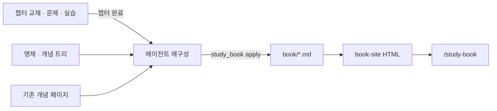
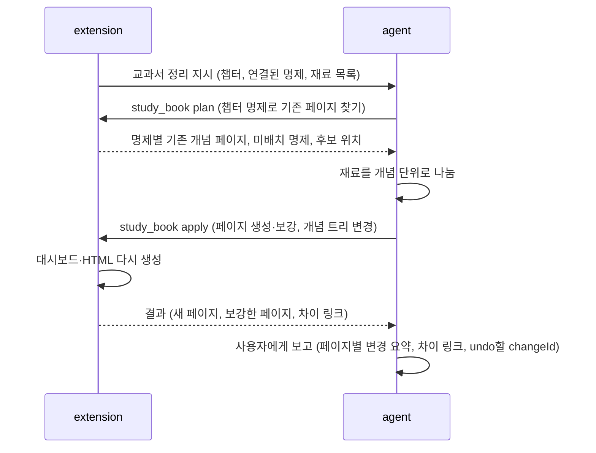

# study 내 교과서 설계 (초안)

> 상태: 확정 v4 · 2026-11-03 · 대상: `runtime/pi/extensions/study` · 1~3단계(개념 모델·book 저장, 완료 연결, HTML 렌더러) 구현 완료 — `feat/study-my-textbook`
> v4 변경: 챕터 README를 그대로 쓰지 않음. 챕터가 끝날 때 에이전트가 README·문제·실습에서 내용을 뽑아 **개념 위계에 맞게 재구성**해 book 페이지를 만들거나 기존 페이지에 합침. 보기는 `/study-book`. 시험 문제도 예시로 씀.

## 목차

- [목표](#목표)
- [확정한 결정](#확정한-결정)
- [용어](#용어)
- [전체 구조](#전체-구조)
- [챕터 완료 때 재구성](#챕터-완료-때-재구성)
- [중복을 막는 방법](#중복을-막는-방법)
- [데이터 모델](#데이터-모델)
- [도구와 권한](#도구와-권한)
- [book 페이지 형식](#book-페이지-형식)
- [대시보드](#대시보드)
- [렌더러와 /study-book](#렌더러와-study-book)
- [기존 기능과의 관계](#기존-기능과의-관계)
- [오류 처리](#오류-처리)
- [테스트](#테스트)
- [구현 단계](#구현-단계)
- [열린 질문](#열린-질문)

## 목표

여러 학습 프로젝트에서 배운 내용을 **개념 위계에 맞게 재구성한 내 교과서**로 쌓는다. 지식백과가 아니다. 시간이 지나도 그때 이해한 흐름을 되살리고, 그 흐름대로 복습하는 것이 목표다.

- 챕터를 마치면 에이전트가 챕터 README·풀었던 문제·실습 자료에서 내용을 뽑는다. 뽑은 내용을 개념 단위로 나눠 book 페이지를 새로 쓰거나 기존 페이지에 합친다
- 같은 개념을 여러 챕터·프로젝트에서 배워도 book에는 한 페이지만 있다. 새 챕터는 그 페이지를 보강한다
- 첫 페이지는 학습 현황 대시보드다. `/study-book`으로 HTML을 연다

하지 않는 것:

- 챕터 README를 book 페이지로 그대로 쓰거나 복사하는 것
- 학습자의 원래 답을 넣는 것
- 공유본과 전용본을 따로 만드는 것, 지금 배포하는 것
- 지식 그래프 기능 확장

## 확정한 결정

| 쟁점 | 결정 |
|---|---|
| 성격 | 내 이해를 기반으로 한 교과서. 지식백과가 아니다 |
| 본문 | 에이전트가 챕터 자료에서 뽑아 개념 단위로 재구성한 글. 챕터 README는 학습 중 교재로 그대로 둔다 |
| 생성 시점 | 챕터 완료(시험 통과와 확인) 때 자동 |
| 예시 | 진단·복습·시험에서 풀었던 문제와 모범 답·해설, 실습 스니펫과 자료. 원래 답은 넣지 않는다 |
| 기준 구조 | 개념 위계(트리) 하나. 개념 하나 = book 페이지 하나 |
| 위계를 만드는 사람 | 상위 영역은 사용자, 하위 개념은 에이전트(만들기, 이름 바꾸기, 옮기기, 쪼개기, 합치기) |
| 파일 배치 | 개념 경로를 디렉터리로 쓴다. 예: `book/동시성/자바 스레드/인터럽트/README.md` |
| 보기 | `/study-book`으로 HTML 교과서를 연다. 명령은 보기만 하고, 생성은 자동이다 |
| 공유 | 구분 없이 하나로 만든다. 상대 경로 정적 디렉터리로 유지하고, 배포는 나중에 정한다 |
| 렌더링 | 직접 구현한다. md 하위 집합 파서와 `mermaid.min.js`만 쓰고, CSP로 외부 요청을 막는다 |
| 적용 방식 | 새 페이지·보강 모두 바로 적용하고 보고한다. 보고에는 어느 페이지에 무엇을 넣었는지와 차이 링크를 담는다. 마음에 안 들면 changeId로 undo |
| 기존 데이터 | 1단계 구현 직후 상위 영역을 함께 정한다. 2026-11-03 기준 시험까지 마친 챕터는 0개 |

## 용어

| 용어 | 뜻 |
|---|---|
| 내 교과서 (book) | 개념 위계에 따라 재구성한 페이지 전체. 디렉터리 `book/` |
| 개념 페이지 | 개념 하나의 book 페이지. 에이전트가 쓰고 고친다 |
| 챕터 교재 | 챕터 `README.md`. 학습 중 교재이자 book의 재료. book이 그대로 복사하지 않는다 |
| 재료 | 챕터 교재, 풀었던 문제(채점 기준 포함), `lab/results.md`, 실습 코드 |
| 명제 | 기존 `knowledge/items`의 지식 하나. 중복을 막는 기준점으로 쓴다 |

## 전체 구조

```text
<study 루트>/
├── study-*/ch-*/README.md          # 재료: 챕터 교재 (변경 없음)
├── knowledge/items/k-*.md          # 정본: 명제 (변경 없음)
├── knowledge/concepts/cn-*.json     # 신규 정본: 개념 노드 (트리·명제 소속·출처)
├── knowledge/concepts/history/     # 신규: 개념·페이지 버전 스냅숏 (추가만)
├── knowledge/concepts/changes/     # 신규: 변경 기록 (멱등 재시도·undo)
├── book/                           # 신규 정본: 개념 페이지 md (Git 추적)
│   ├── README.md                   #   대시보드 (생성물)
│   └── <영역>/<개념>/README.md      #   개념 페이지 (에이전트 작성 + 사용자 메모)
└── .study/local/book-site/         # 로컬 HTML (PC 전용, 다시 생성 가능)
```



## 챕터 완료 때 재구성

기존 `completeAcknowledgedTest`(시험 통과와 확인 → 상태 저장 → 복습 등록 → 복습 페이지)가 끝난 뒤, extension이 agent에게 **교과서 정리 지시를 한 번** follow-up으로 보낸다. 시험 단계에서 `study_test_open`을 교정할 때와 같은 방식이다.



재구성 원칙 (`instructions/book.md`, 정본):

1. **개념 단위로 나눈다.** 한 챕터는 보통 개념 여러 개에 걸친다. 챕터 순서가 아니라 개념의 위계에 맞춰 배치한다
2. **있으면 보강, 없으면 새로 쓴다.** 같은 개념 페이지가 있으면 새 내용을 그 흐름 안에 녹인다. 끝에 덧붙이지 않는다. 이미 있는 설명과 같은 말이면 넣지 않고, 새 관점·조건·예시만 더한다
3. **교재 품질 원칙을 따른다.** 핵심 한 문장 → 예시·그림 → 필요한 보충 (기존 `instructions/concept.md`와 같은 원칙)
4. **예시는 근거가 있는 것만 쓴다.** 문제는 질문 id, 실습은 lab step id와 파일·줄 범위가 있어야 한다. 확인하지 않은 코드나 출력은 만들지 않는다
5. **배운 곳을 남긴다.** 페이지 끝 "배운 곳"에 챕터 링크를 쌓는다. 본문 문단마다 출처를 달지는 않는다
6. **챕터 범위만 다룬다.** 챕터에서 배우지 않은 내용을 book에 새로 쓰지 않는다

## 중복을 막는 방법

재구성의 핵심 위험은 같은 내용이 여러 페이지에 생기는 것이다. 다음 세 가지로 막는다.

| 장치 | 동작 |
|---|---|
| **명제가 기준점** | 명제는 개념 페이지 한 곳에만 속한다(`concepts[].members`). 챕터에 연결된 명제가 이미 어떤 페이지에 속해 있으면, `study_book plan`이 그 페이지를 보강 대상으로 돌려준다 |
| **apply 검사** | 이미 다른 페이지에 속한 명제를 새 페이지에 넣으려 하면 거부한다. 명제를 옮기려면 `move_member`를 명시해야 한다 |
| **다른 페이지 언급은 링크로** | 다른 개념을 설명해야 하면 한 줄 요약과 링크만 쓴다. 지침과 apply 검사로 강제한다. apply 검사는 다른 페이지 소속 명제의 이름이 제목으로 나오면 경고한다 |

명제가 없는 챕터(미등록 프로젝트 등)는 개념 이름·별칭으로 후보를 찾는다. 판단이 모호하면 새 페이지를 만들지 않고 보고에 "확인 필요"로 남긴다.

## 데이터 모델

```ts
type ConceptNode = {
  schemaVersion: 1;
  id: string;              // cn-<uuid>. 이름·위치가 바뀌어도 바뀌지 않는다 (추론 사슬 id가 c-를 쓰므로 cn-)
  version: number;
  revisionId: string;
  name: string;            // 표시 이름이자 디렉터리 이름
  parentId: string | null; // 상위 개념 하나. null이면 최상위 영역
  owner: "user" | "agent"; // 트리 구조(이름·위치)를 누가 바꿀 수 있는지
  order: number;
  aliases: string[];
  members: string[];       // 이 페이지에 속한 명제 id (명제는 한 곳에만)
  learnedIn: Array<{ projectId: string; chapterSlug: string; completedOn: string }>;
  related: string[];
  retired?: { into?: string; at: string };
};
```

- 페이지 본문은 `book/…/README.md`에 둔다. JSON에는 본문을 넣지 않는다. 직접 수정 감지는 페이지 관리 영역의 hash로 하고, 동시 변경은 개념 노드의 revisionId로 막는다(페이지를 쓰면 노드 revision도 올라감).
- 변경 기록(`changes/<changeId>.json`)에 바뀐 파일의 전후 내용을 남긴다. undo는 그 파일들이 그대로일 때만 전 내용으로 되돌리므로 트리와 본문이 함께 돌아간다. `history/`에는 노드 스냅숏만 추가한다.
- 페이지 관리 영역은 세 개다: `head`(경로·하위 개념 목차, 자동), `main`(에이전트 본문), `foot`(배운 곳, 자동). 영역 밖은 사용자 메모다.
- 이름은 파일 시스템에서 쓸 수 없는 문자를 거부하고, 형제 이름 중복도 거부한다.
- 쓰기는 모두 기존 `change-plan`(전후 내용 저장, hash 비교, 원자적 교체)을 거친다.

## 도구와 권한

| 도구 | 사용자 | 용도 |
|---|---|---|
| `study_book` (agent) | — | `plan`: 챕터 명제로 기존 페이지·미배치 명제 찾기. `query`: 트리·페이지 조회. `apply`: 아래 operation |
| `/study-book` | 사용자 | HTML 교과서 열기. 인자로 개념 이름을 주면 그 페이지로 연다(자동완성) |
| `/study-concepts` | 사용자 | 상위 영역 만들기·이름 바꾸기·옮기기, 제안 승인·거절 |

`study_book apply` operation:

| operation | 설명 |
|---|---|
| `write_page` | 개념 페이지를 새로 쓰거나 관리 영역을 고친다. 기대 `pageHash` 필수 |
| `create` / `rename` / `move` / `retire` | 하위 개념 트리 변경. 페이지 파일도 함께 옮긴다. `retire`는 메모를 `into` 페이지로 옮기고 페이지를 지운다 |
| `place` / `unplace` / `move_member` | 명제를 페이지에 넣거나 빼거나 옮긴다 |
| `adopt_page` | 사용자가 직접 고친 본문을 새 기준으로 받는다 (사용자에게 물은 뒤) |
| `record_learned` | "배운 곳"에 챕터를 남긴다 |

쪼개기(split)와 합치기(merge)는 따로 두지 않고 한 묶음으로 조합한다. 쪼개기 = `create` + `move_member` + `write_page`, 합치기 = `move_member` + `write_page` + `retire(into)`. 같은 묶음에서 새로 만든 개념은 `create`의 `key`로 이름 붙여 `key:<key>`로 가리킨다.
| `propose` | `owner: user` 노드의 변경을 제안만 한다 |
| `undo` | changeId 단위로 되돌린다 (트리와 본문 모두) |

- 여러 operation을 한 changeId로 묶어 **원자적으로** 적용한다. 예: 개념 만들기 + 명제 배치 + 페이지 쓰기
- 에이전트는 `owner: user` 노드의 이름·위치를 바꿀 수 없다. 그 아래에 하위 개념을 만들고 페이지 본문을 쓰는 것은 허용한다. 최상위 영역은 만들 수 없다
- 에이전트 도구에는 actor 인자를 두지 않는다. 사용자 쪽 변경은 `/study-concepts`로만 한다
- 모든 apply에는 `changeId`·`reason`·기대 revision이 필요하다

## book 페이지 형식

~~~markdown
---
concept: cn-1a2b3c4d
---
<!-- study:book region=head hash=… -->
[동시성](../../README.md) › [자바 스레드](../README.md) › **인터럽트**

# 인터럽트
<!-- /study:book -->

<!-- study:book region=main hash=… -->
(핵심 한 문장)

## 설명
(재구성한 본문: 그림·Mermaid 포함)

## 예시
### 문제: 인터럽트를 무시하는 반복문
(문제) → (모범 답·해설)

### 실습: 인터럽트 플래그 복원
```java
(lab 스니펫)
```
(관찰한 출력)

## 관련
- [취소와 종료](…): 한 줄 요약
<!-- /study:book -->

<!-- study:book region=foot hash=… -->
## 배운 곳
- [study-java-threads · ch-01 스레드 생성·생명주기·인터럽트](…) · 2026-11-10
<!-- /study:book -->

## 메모
(관리 영역 밖: 사용자가 자유롭게 쓰고 에이전트가 보존)
~~~

- 하위 개념이 있는 페이지는 본문 앞에 하위 개념 목차를 자동으로 넣는다.
- 예시의 근거(질문 id, lab step, 파일 줄 범위)는 관리 영역 주석의 메타에 남기고, 화면에는 보이지 않는다.
- 사용자가 관리 영역을 직접 고쳤으면(hash 불일치) 에이전트 apply는 보류한다. 다음 중 하나를 사용자에게 묻는다: 수정본을 새 기준으로 받기, 에이전트 버전 적용, 둘을 합쳐 다시 쓰기. 기존 챕터 교재 관리 영역과 같은 정책이다.
- 개념 이름 바꾸기·이동으로 경로가 바뀌면 Git rename이 되도록 옮긴다. 메모도 함께 옮긴다.

## 대시보드

`book/README.md`. 챕터 완료, book 변경, 복습 기록 때 다시 만든다.

- 영역별 개념 페이지 수, 완료 챕터 수, 진행 중 챕터
- 개념 트리 목차
- 프로젝트·챕터 진행 (`state.json`)
- 오늘·밀린 복습 수 (`review/items`)
- 미배치 명제, 교과서 정리가 안 된 완료 챕터, 확인 필요, 검토할 제안, 최근 book 변경

복습 화면에서 정답을 보이지 않는다는 기존 원칙은 그대로다. 대시보드는 이름과 개수만 보여 준다.

## 렌더러와 /study-book

`src/book/` 아래:

| 파일 | 역할 |
|---|---|
| `md-parse.ts` | 하위 집합 파서: 제목, 문단, 굵게/기울임/인라인 코드, 링크, 목록(중첩), 인용, 코드 블록(``` 와 ~~~), GFM 표, 수평선, frontmatter |
| `md-html.ts` | AST → HTML. 모든 텍스트 escape, raw HTML은 출력하지 않음(관리 주석만 제거) |
| `highlight.ts` | java·kotlin·sql·json·sh용 가벼운 토큰 강조 |
| `site-build.ts` | `book/` → HTML, `.md` 링크 → `.html` 변환, 왼쪽 트리, 상단 경로, 이름·별칭 검색 색인 |
| `book-command.ts` | `/study-book [개념]`: 필요하면 빌드한 뒤 기존 loopback bridge로 연다 |

- **렌더링 대상:** `book/`만. "배운 곳"의 챕터 교재 링크는 GitHub에서는 원본 md로, HTML에서는 챕터 교재를 렌더링한 보조 페이지로 연다. 보조 페이지는 트리에 넣지 않는다.
- **Mermaid:** `assets/vendor/mermaid.min.js`에 고정 버전으로 포함하고, 라이선스(MIT)와 버전을 기록한다.
- **보안:** 페이지마다 CSP `<meta>`를 넣는다. `default-src 'none'; script-src 'self'; style-src 'self'; img-src 'self' data:`. 외부 URL은 링크로만 둔다.
- **상대 경로만:** `file://`로 열어도, 나중에 정적 호스팅에 올려도 그대로 동작한다.

## 기존 기능과의 관계

| 기존 기능 | 변화 |
|---|---|
| 시험 완료 (`completeAcknowledgedTest`) | 끝에 교과서 정리 follow-up을 추가한다. 실패는 경고 |
| 챕터 교재 (README, `study:knowledge` 영역) | 그대로. book의 재료로 읽기만 한다 |
| `instructions/concept.md` | 그대로. 새 `instructions/book.md`가 재구성 원칙의 정본이다 |
| `study_knowledge` | 그대로. 명제 merge 때 `members`도 같은 변경 계획 안에서 합친다(2단계). 1단계에서는 무결성 검사가 "병합된 지식이 남아 있음"으로 알린다 |
| 지식 영역(Louvain) | 미배치 명제를 묶을 때 힌트로만 쓴다 |
| `/study-knowledge-graph` | 그대로 둔다 |
| 통합 복습 | 그대로. 대시보드가 개수만 읽는다 |

## 오류 처리

- 손상된 `cn-*.json`은 다시 만들지 않고 오류로 알린다. 세션 시작 점검에 검사를 추가한다: 순환, 없는 상위 개념, 명제 중복 소속, 없는 명제, 형제 이름 중복, 개념과 페이지 파일 불일치.
- 교과서 정리가 실패하거나 중간에 끊겨도 챕터 완료는 유지한다. 완료 챕터 중 `learnedIn`에 없는 것을 "교과서 정리 대기"로 대시보드와 세션 시작 알림에 보여 준다. `/study-chapter` 메뉴에서 이어서 처리할 수 있다.
- 렌더링할 수 없는 md 요소는 원문을 `<pre>`로 보여 주고, 빌드 보고에 위치를 남긴다.

## 테스트

- `tests/book/book-apply.test.ts`: operation별 권한, 순환 거부, 명제 중복 소속 거부, 원자적 묶음 적용, undo로 본문 복원
- `tests/book/book-plan.test.ts`: 챕터 명제 → 기존 페이지 찾기, 미배치 명제, 명제가 없을 때 이름·별칭 후보
- `tests/book/page-regions.test.ts`: 관리 영역 hash, 직접 고친 영역 보류, 메모 보존, 이동 후 메모 보존
- `tests/book/completion-hook.test.ts`: 시험 완료 → follow-up 1회, 실패해도 완료 유지, 정리 대기 표시
- `tests/book/md-parse.test.ts`, `site-build.test.ts`: 하위 집합 요소, escape, 링크 변환, CSP
- `tests/integration`: `study_book` 도구, `/study-book`·`/study-concepts` 명령 등록

## 구현 단계

1. **개념 모델과 book 저장**: `knowledge/concepts`, `study_book` 도구(plan·query·apply), 관리 영역, `/study-concepts`, 무결성 검사. 끝나면 상위 영역을 함께 정한다
2. **완료 연결**: 시험 완료 follow-up, `instructions/book.md`, 대시보드, 정리 대기 알림
3. **렌더러**: 파서, 강조, Mermaid, `/study-book`
4. (나중) **링크 공유**

1~2단계만 끝나도 GitHub에서 `book/`을 교과서로 읽을 수 있다.

## 열린 질문

없음. 링크 공유 방식은 4단계에서 정한다.

보고 형식: apply 결과는 페이지마다 `created | updated | moved | removed`와 이전 경로를 돌려준다(1단계). 차이 링크는 3단계 렌더러와 함께 넣는다. 차이 링크는 `.study/local/book-diff/<changeId>.html`에 적용 전후를 비교해 렌더링한 페이지로, `/study-book`에서도 연다. 마지막으로 undo할 changeId를 함께 돌려준다. 대시보드의 "최근 book 변경"에서도 같은 차이 링크를 연다.
