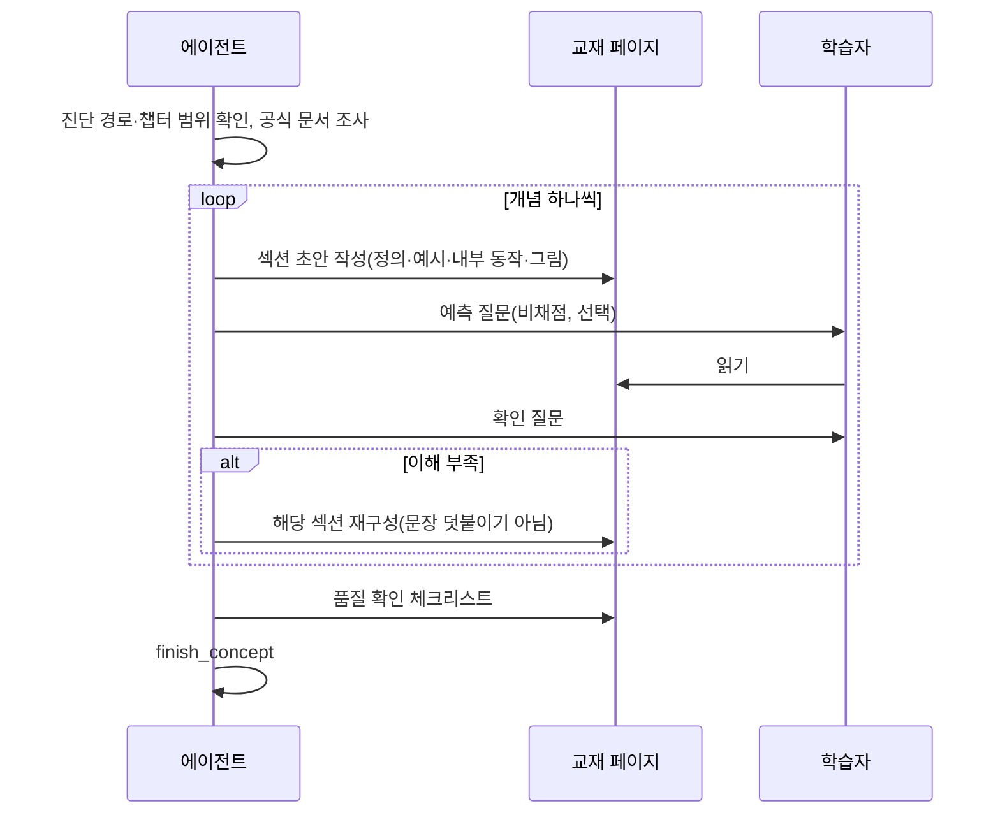
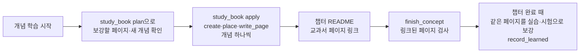

# study 개념 학습 교재 품질 고도화 설계 (초안)

> 상태: 구현 완료 · 2026-11-16 · 대상: `runtime/pi/extensions/study` · 구현 계획: `2026-11-16-study-concept-textbook-quality.md`
> v2 변경: 개념 학습 중 book 페이지에 바로 쓴다. 챕터 README에는 학습 지도와 페이지 링크만 둔다. 시범 적용 챕터는 정하지 않는다.

## 목차

- [목표](#목표)
- [확정한 결정](#확정한-결정)
- [현재 문제](#현재-문제)
- [전체 흐름](#전체-흐름)
- [페이지 구성 (깊이)](#페이지-구성-깊이)
- [그림 (diagram-design SVG)](#그림-diagram-design-svg)
- [정확성](#정확성)
- [품질 확인](#품질-확인)
- [바꾸는 것](#바꾸는-것)
- [하지 않는 것](#하지-않는-것)
- [기존 프로젝트 호환](#기존-프로젝트-호환)

## 목표

개념 학습에서 학습자가 읽는 자료가 그대로 교과서(`book/`)가 된다. 나중에 다시 읽었을 때 그때의 이해가 되살아나야 한다.

- **깊이**: 정의와 요약에서 멈추지 않는다. "왜 그런지"와 내부 동작을 한 단계 아래까지 설명한다
- **그림**: 연결·흐름·순서 같은 개념 구조를 diagram-design SVG로 그려 직관적으로 보이게 한다
- **완결**: 교과서는 `book/` 안의 내용만 의존한다(2026-11-16 적용 완료)

## 확정한 결정

| 쟁점 | 결정 | 근거 |
|---|---|---|
| 가장 아쉬운 점 | 깊이 부족 + 개념 구조를 그림으로 보기 어려움 | 사용자 답변 |
| 작성 시점 | 교재를 먼저 쓰고 그 교재로 수업한다(A-②) | 추천안에 사용자 동의 |
| 그림 | 모두 diagram-design SVG | 사용자 선택 |
| 그림 스타일 | 가장 단순한 색과 톤 | 사용자 피드백 |
| 교과서 의존 | `book/` 안의 파일만. 웹 링크는 허용 | 사용자 피드백, 구현 완료(`3e18546`) |
| `배운 곳` 챕터 링크 | 유지 | 사용자 선택 |
| 교재 위치 | 개념 학습 중 book 페이지에 바로 쓴다. 챕터 README에는 학습 지도와 `교과서 페이지` 링크만 둔다 | 사용자 선택(b) |
| 시범 적용 | 정하지 않음. 다음 학습 때 자연히 적용 | 사용자 선택 |

## 현재 문제

- 교재 품질 규칙이 `instructions/concept.md`의 서술형 문장 몇 줄뿐이다. 섹션 틀, 깊이 기준, 그림 기준이 없다
- 교재를 대화가 끝난 뒤 한 번에 요약해서 쓴다. 대화에서 이해한 흐름이 빠지기 쉽다
- 완료 검사(`chapter-evidence.ts`)는 노트가 비어 있지 않은지만 본다
- 그림은 Mermaid뿐이다. 개념 구조를 보여 주기에는 표현력이 부족하다
- 출처 확인과 예시 코드 실행 절차가 없다

## 전체 흐름

교재를 먼저 쓰고, 학습자가 그 교재를 읽으며 대화한다. 대화에서 드러난 빈틈은 교재를 다시 구성해서 메운다.



- 한 번에 페이지 전체를 쓰지 않는다. 개념 하나(섹션 묶음 하나)씩 쓰고 바로 수업한다
- 학습자의 답·오답은 교재에 넣지 않는다(기존 원칙 유지). 오답에서 드러난 **오해 유형**만 "흔한 오해"의 재료가 된다

### 교재 위치: book 페이지에 바로



- 개념 학습을 시작하면 `study_book plan`으로 이 챕터 지식이 이미 속한 페이지와 미배치 지식을 확인한다. 같은 개념 페이지가 있으면 보강하고, 없으면 하위 개념을 만든다
- 교재 본문은 `write_page`로 쓴다. 개념 하나를 가르칠 때마다 쓰므로 한 페이지에 여러 번 쓸 수 있다. 각 변경은 undo할 수 있다
- 공통 지식(명제)은 지금처럼 `study_knowledge`로 만들고, `study_book place`로 페이지에 넣는다. 챕터와 지식의 연결(binding)은 복습 일정을 만드는 데 계속 쓴다
- 챕터 README의 `## 교과서 페이지` 섹션에 이번에 쓴 book 페이지 링크를 둔다. 챕터 README는 book 밖이므로 book을 링크해도 된다(반대 방향 링크는 `배운 곳`뿐)
- 챕터 README에는 지식 관리 영역(`study:knowledge`)을 더 넣지 않는다. 교재가 book에 있으므로 README에 명제를 복사할 이유가 없다
- 챕터가 끝나면(시험 통과) 기존 book 재구성 단계는 **보강**으로 바뀐다. 개념 학습 때 쓴 페이지에 검증된 실습 출력·시험 문제를 예시로 더하고 `record_learned`를 남긴다

## 페이지 구성 (깊이)

개념 하나의 기본 순서다. 개념에 맞지 않는 섹션은 뺀다. 고정된 문서 양식이 아니라 빠뜨리지 않기 위한 순서다.

| 순서 | 섹션 | 담는 것 | 깊이 기준 |
|---|---|---|---|
| 1 | 왜 필요한가 | 이 개념이 푸는 문제. 이 개념이 없으면 무엇이 깨지는지 | 구체적 상황 하나로 시작 |
| 2 | 핵심 한 문장 | 정의 | 복습할 때 이 문장만 읽어도 떠오르게 |
| 3 | 최소 예시 | 가장 작은 코드·명령과 실제 출력 | 실행해서 확인한 출력만 |
| 4 | 내부 동작 | 예시가 실행되는 동안 일어나는 일. 중간 상태, 누가 무엇을 바꾸는지 | API 아래 한 단계(런타임·OS·자료구조)까지. **그림 1순위** |
| 5 | 왜 이렇게 설계됐나 | 다른 선택지와 비용. 이 설계가 지키는 것 | 트레이드오프 하나 이상 |
| 6 | 성립 조건과 경계 | 언제 성립하고 언제 깨지는지 | 공식 보장 / 구현 세부 / 이번 관찰을 구분 |
| 7 | 흔한 오해 | 틀리기 쉬운 생각과 바른 설명 | 진단·확인 질문에서 드러난 오해 유형 우선 |
| 8 | 비교 | 비슷한 개념과의 차이 | 표 하나. 다른 개념 상세는 링크로만 |
| 9 | 스스로 확인 | 질문 2~3개, 페이지 맨 끝 `풀이`에 답 | 정의를 되묻지 않고 예측·판단을 묻는다 |
| 10 | 출처 | 공식 문서 링크 | 주요 주장마다 |

**"깊이"를 판단하는 기준** (에이전트 자가 점검)

- 동작을 설명하는 문장마다 "무엇이 그렇게 만드는가"에 답했는가
- 내부 동작 섹션에 시간 순서(전·중·후 상태)가 있는가
- 예시의 출력이 왜 그렇게 나오는지 본문만 읽고 설명할 수 있는가
- "~하면 된다"로 끝나는 규칙이 있으면, 그 규칙이 생긴 이유가 함께 있는가

**확인 질문의 답을 맨 끝에 두는 이유**: 교과서 렌더러는 raw HTML(접기)을 지원하지 않는다. 그래서 답을 페이지 맨 끝 `풀이` 섹션에 두어 바로 보이지 않게 한다.

## 그림 (diagram-design SVG)

### 언제 그리나

diagram-design의 원칙을 교과서 기준으로 쓴다.

- 문단보다 그림이 나을 때만 그린다. 목록이나 속성 비교는 표로 쓴다
- 그림 하나에 노드 9개 이하. 넘으면 그림 두 개로 나눈다. 밀도 4/10
- 의미 패턴(라이프사이클, 흐름, 순서, 계층 등)을 먼저 고르고 유형을 정한다

| 개념 구조 | 유형 예시 |
|---|---|
| 상태와 전이(스레드 상태, TCP 연결) | state machine |
| 여러 주체의 순서(fork/exec/wait, 요청 처리) | sequence |
| 데이터·제어 흐름(파이프, 쿼리 처리 단계) | data flow / flowchart |
| 포함·계층(메모리 영역, 레이어) | layers / nested / tree |
| 시간에 따른 변화(GC 단계) | timeline / swimlane |

- 페이지당 핵심 그림 1~3개. "내부 동작" 섹션이 1순위다

### 만드는 과정과 저장 위치

```
book/_media/<개념 ID>/
├── <이름>.html   # diagram-design 원본(수정할 때 이것을 고친다)
└── <이름>.svg    # 본문이 넣는 그림
```

1. diagram-design으로 HTML을 만든다
2. `python3 scripts/export_svg.py <html> <svg> --system-fonts`로 SVG를 뽑는다
3. `python3 scripts/self_check.py --offline <html>`로 검사한다(외부 요청 없음, 접근성 title/desc, viewBox 안에 그려졌는지)
4. 본문에 `` 형태의 상대 경로로 넣는다. 설명(alt)에는 그림이 말하는 내용을 한 문장으로 쓴다

- 본문은 그림이 없어도 읽히게 쓴다. 그림은 설명을 대신하지 않고 구조를 보여 준다
- 원본 HTML을 함께 두는 이유: SVG만 있으면 고칠 때 처음부터 다시 그려야 한다

### 스타일: 가장 단순한 색과 톤

study 전용 프로필 `~/.diagram-design/profiles/study-plain.md`를 만들고, study 루트에 `.diagram-design` 파일(`profile: study-plain`)을 둔다. 다른 프로젝트의 diagram-design 설정에는 영향이 없다.

| 역할 | 값 | 비고 |
|---|---|---|
| `paper` | `#ffffff` | 흰 배경 |
| `paper-2` | `#f5f5f5` | 영역 배경 |
| `ink` | `#111111` | 글자·주요 선 |
| `ink-strong` | `#ffffff` | 검정 강조 면 위의 글자(대비 검사 결과 흰색) |
| `muted` | `#555555` | 보조 글자·기본 화살표 |
| `soft` | `#666666` | 부가 라벨 |
| `rule` / `rule-solid` | `rgba(0,0,0,0.12)` / `#cccccc` | 얇은 선 |
| `accent` | `#111111` + 굵은 선 | 색 대신 굵기로 강조. 그림당 1곳 |
| `accent-tint` | `rgba(0,0,0,0.05)` | 강조 상자 배경 |
| `link` | `#555555` | 별도 색 없음 |
| Font source | `system` | 웹 폰트 없음(오프라인 CSP와 맞음) |

- 대비 기준(WCAG 4.5:1)은 모두 통과하는 값이다. 프로필을 저장할 때 diagram-design의 대비 검사로 다시 확인한다
- HTML 교과서의 다크 모드에서는 흰 카드처럼 보인다. 그림 안 색을 바꾸지 않아 읽는 데는 문제가 없다

## 정확성

- **출처**: 주요 주장(동작·보장·수치)마다 공식 문서를 실제로 열어 확인하고 `출처`에 링크한다. 확인하지 못한 주장은 본문에 "확인 필요"로 표시하고 단정하지 않는다
- **예시 실행**: 최소 예시와 출력은 실제로 실행한 결과만 쓴다. 실행 환경(언어 버전 등)을 한 줄 남긴다. 실행할 수 없는 예시(운영 환경 등)는 "실행하지 않은 예시"로 표시한다
- **구분 표시**: 언어·표준의 보장, 특정 구현(예: HotSpot, glibc)의 동작, 이번 실행의 관찰을 문장에서 구분한다(기존 원칙 유지)

## 품질 확인

에이전트가 개념 학습을 끝내기(`finish_concept`) 전에 확인한다.

1. **자가 점검 체크리스트**(지침): 위 깊이 기준 4개, 그림 기준, 출처와 실행 여부
2. **구조 경고**(코드, 막지 않음): `finish_concept` 때 교재에 다음이 없으면 경고를 돌려준다
   - "내부 동작"에 해당하는 섹션
   - SVG 그림 1개 이상
   - 출처 링크 1개 이상
   - 경고만 하고 완료는 막지 않는다. 그림이 필요 없는 개념도 있기 때문이다
3. **학습자 피드백**: 학습자가 "이 부분 모르겠다"고 하면 그 섹션을 다시 구성한다. 문장을 덧붙이지 않는다

리뷰어 에이전트를 따로 두는 방식은 이번에 하지 않는다. 체크리스트와 구조 경고로 부족하면 그때 추가한다.

## 바꾸는 것

| 대상 | 변경 |
|---|---|
| `instructions/concept.md` | 교재 먼저 쓰기 흐름, 페이지 구성, 깊이 기준, 그림 기준과 과정, 정확성, 자가 점검으로 재작성 |
| `instructions/book.md` | 위 페이지 구성과 그림 규칙을 공유. 챕터 완료 때 검증된 예시(실습 출력·시험 문제)로 보강 |
| `prompts/study-init.md` | 챕터 README 템플릿의 `개념 학습 노트` 설명을 새 흐름에 맞춤 |
| `src/session` (`finish_concept`) | 구조 경고 추가 |
| `src/session/chapter-evidence.ts`, `study-state.ts` | 챕터 README의 `교과서 페이지` 링크가 가리키는 book 페이지에 본문이 있는지 확인. 예전 `개념 학습 노트`도 허용 |
| `src/session/concept-completion.ts` | README 관리 영역 검사 대신 링크된 book 페이지 검사 + 구조 경고 |
| diagram-design 프로필 | `~/.diagram-design/profiles/study-plain.md` 생성, study 루트에 `.diagram-design` 마커 추가 |
| 테스트 | 구조 경고, 근거 확인 위치 변경 |

## 하지 않는 것

- 기존 교과서 페이지 277개를 새 구성으로 다시 쓰지 않는다. 새로 배우는 챕터부터 적용하고, 기존 페이지는 다시 배울 때 보강한다
- Mermaid 렌더링 지원을 없애지 않는다. 기존 페이지에 있는 Mermaid는 그대로 둔다
- 리뷰어 에이전트, 분량 기준(몇 자 이상) 같은 수치 규칙을 두지 않는다

## 기존 프로젝트 호환

- `개념 학습 노트`가 있는 README(예전 방식)는 개념 학습 완료·챕터 완료 검사에서 계속 인정한다. 2026-11-16 기준 이런 챕터는 0개다
- `study_textbook_refresh`(README 관리 영역)는 예전 방식 챕터를 위해 남겨 두되, 개념 지침에서는 더 쓰지 않는다. 챕터-지식 연결(bindingJson) 저장은 이 도구로 계속 한다
- 챕터 README는 만들 때부터 학습 지도만 담는다. `교과서 페이지` 섹션은 개념 학습 중 추가한다
