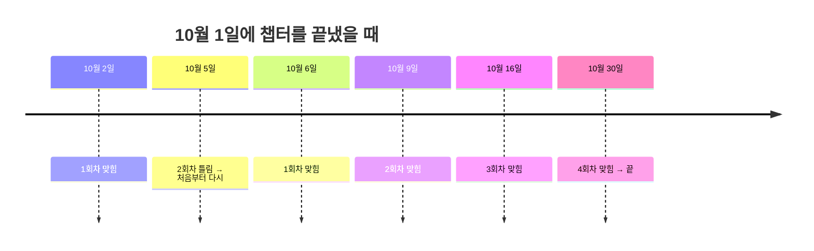
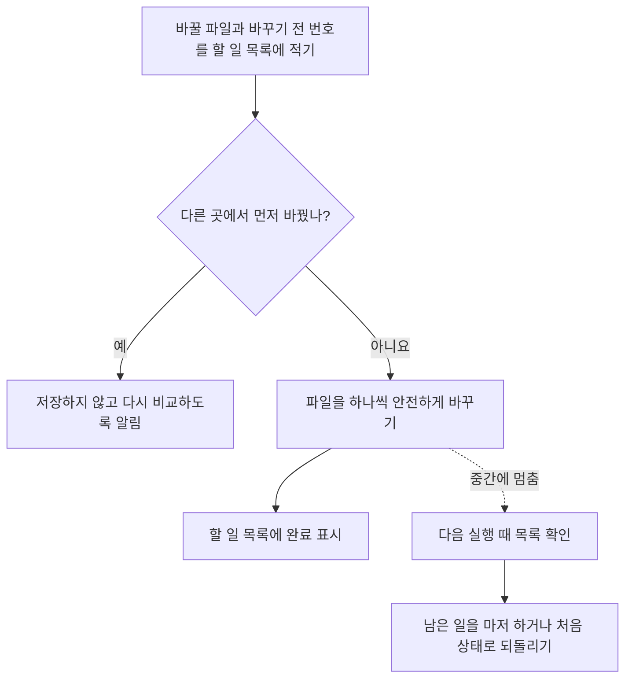

# 저장·복구·기존 복습 이전 — 추천안

## 목차

- [문서 상태](#문서-상태)
- [한눈에 보기](#한눈에-보기)
- [1. 파일을 어디에 둘까](#1-파일을-어디에-둘까)
- [2. 이름표와 고친 기록](#2-이름표와-고친-기록)
- [3. 복습 날짜 계산](#3-복습-날짜-계산)
- [4. 저장하다 멈추면](#4-저장하다-멈추면)
- [5. 교재의 공통 부분을 내가 고쳤다면](#5-교재의-공통-부분을-내가-고쳤다면)
- [6. 다른 PC에서 열면](#6-다른-pc에서-열면)
- [7. 기존 복습 옮기기](#7-기존-복습-옮기기)
- [사용자가 정할 것](#사용자가-정할-것)
- [검증 방법](#검증-방법)

## 문서 상태

- **승인됨.** 세 가지는 “추천대로 진행”, 나머지는 2026-10-30 “진행해”로 승인. 최종 설계 [2026-10-30-study-learnharness-design.md](../2026-10-30-study-learnharness-design.md)에 통합
- 확정: 복습 간격 `+1 / +3 / +7 / +14일`, redis 복습은 자동 시작 없음, 힌트 후 정답은 처음 간격부터 다시
- 이미 정한 것: 마지막 간격 뒤 종료, 틀리면 짧은 간격부터 재시작, 시작일은 챕터를 끝낸 날, 하루 복습 양 제한 없음, 기존 복습은 새 통합 복습으로 이전
- 실제 study 저장소 확인은 **읽기만 수행**. 파일 생성·수정·이전 없음
- 파일 이름과 형식은 설계 예시. 구현할 때 더 단순한 방법이 있으면 바꿀 수 있음

## 한눈에 보기

| 질문 | 추천 |
|---|---|
| 공통 노트는 어디에? | study 루트의 `knowledge/`. 내용 하나에 파일 하나 |
| 복습 일정은 어디에? | 루트의 `review/`. 기억할 내용마다 일정 파일 하나 |
| 고친 기록은? | 지우지 않고 계속 이어 적는 변경 기록 |
| 저장하다 멈추면? | 먼저 “할 일 목록”을 적고 저장. 다음 실행 때 마저 하거나 되돌림 |
| 교재를 내가 고쳤다면? | 덮어쓰지 않고 보류한 뒤 알려줌 |
| 다른 PC에서는? | 절대 경로 대신 루트 기준 위치를 사용 |
| 기존 복습은? | 원본은 그대로 두고, 새 통합 복습에 연결 |

## 1. 파일을 어디에 둘까

```text
study/
├── .study/
│   ├── workspace.json      # "여기가 study 루트"라는 표시와 공통 설정
│   └── local/              # 이 PC에서만 쓰는 것. Git에 올리지 않음
├── knowledge/
│   ├── items/              # 기억할 내용 하나당 Markdown 파일 하나
│   ├── chains.jsonl        # "이것들이 함께 맞으면 저것도 맞다" 연결
│   └── history/            # 고친 기록. 지우지 않고 이어 적음
├── review/
│   ├── items/              # 기억할 내용 하나당 복습 일정 파일 하나
│   └── sessions/           # 실제 복습 때 한 질문과 내 답
├── backlog/
└── study-*/                # 기존 프로젝트. 위치 그대로
```

**내용마다 파일을 나누는 이유**

- 두 PC에서 서로 다른 내용을 고쳐도 Git에서 같은 파일이 부딪히지 않음
- 한 내용이 망가져도 다른 내용은 그대로 읽을 수 있음
- 사람이 직접 열어 읽기 쉬움

**`.study/local/`에 두는 것**

- 이 PC의 외부 자료 위치
- 작업 중 잠금 표시
- 다시 만들 수 있는 지도·검색용 캐시
- 이 폴더는 `.gitignore`에 추가. 지워도 학습 기록은 사라지지 않아야 함

## 2. 이름표와 고친 기록

### 이름표

- 기억할 내용마다 바뀌지 않는 이름표 부여. 예: `k-7f3a9c`
- 문장이나 파일 경로로 만들지 않음. 문장을 고쳐도, 폴더를 옮겨도 이름표는 그대로
- 화면에는 이름표 대신 짧은 제목 표시

### 고친 기록

내용을 고칠 때마다 번호가 하나씩 올라갑니다.

```text
k-7f3a9c v1  처음 적은 설명
k-7f3a9c v2  마지막 숫자를 12 → 11로 바로잡음. 이유: 순서를 다시 따라가 확인
```

- `knowledge/items/k-7f3a9c.md`에는 **최신 설명**
- `knowledge/history/k-7f3a9c.jsonl`에는 **v1, v2의 전체 내용과 고친 이유**
- 내 답은 “어느 번호의 설명을 보고 답했는지”를 함께 기록. 예: `k-7f3a9c@v1`
- 그래서 설명을 고쳐도 예전 답은 당시 설명과 함께 남음

### 합치기와 되돌리기

같은 뜻인 `k-B`를 `k-A`에 합칠 때:

1. `k-B` 파일을 지우지 않고 “`k-A`로 합쳐짐” 표시만 남김
2. 새로 찾을 때는 `k-A`로 안내
3. `k-B`에 연결된 예전 답과 출처는 그대로 둠

잘못 합쳤다면 표시만 지우면 `k-B`가 원래대로 돌아옵니다. 다른 공부 기록은 건드리지 않습니다.

## 3. 복습 날짜 계산

### 이미 정한 규칙

- 시작일은 **챕터를 끝낸 날**
- 마지막 간격을 마치면 **끝**
- 틀리면 **가장 짧은 간격부터 다시**
- 하루 복습 양은 **제한 없음**. 원할 때 멈추고, 남은 것은 다음에

### 추천하는 세부 규칙

| 상황 | 추천 |
|---|---|
| 챕터를 끝낸 날 | 그 챕터의 **완료 시험을 통과한 날**. 시험을 건너뛰었다면 챕터를 완료 처리한 날 |
| 늦게 복습함 | 다음 날짜는 **실제로 복습한 날**부터 계산 |
| 틀림 | 틀린 날부터 가장 짧은 간격으로 다시 계산 |
| 힌트를 받고 맞힘 | **확정.** 혼자 떠올린 것이 아니므로 틀린 것과 같이 처음 간격부터 다시. 답의 기록에는 “힌트 후 정답”으로 남김 |
| 한 질문에 여러 내용 | 실제로 맞힌 내용과 틀린 내용을 따로 계산 |
| 아직 날짜가 안 된 복습 | 미리 당겨서 하지 않음 |
| 날짜 기준 | 루트 설정의 시간대 사용. 기본값 추천: `Asia/Seoul` |

**예시** — 간격이 `+1일 / +3일 / +7일 / +14일`이라면:



**확정:** 복습 간격은 `+1 / +3 / +7 / +14일`. 기존 redis 일정과 같은 간격이며, 특정 간격이 연구상 최적이라는 뜻은 아님.

## 4. 저장하다 멈추면

내용 하나를 고치면 여러 파일이 함께 바뀔 수 있습니다.

- 공통 노트
- 고친 기록
- 교재의 공통 부분
- 복습 일정

중간에 멈추면 일부만 바뀐 상태가 될 수 있습니다. 그래서 **할 일 목록을 먼저 적는 방식**을 추천합니다.



- **할 일 목록 위치:** `.study/local/pending/`
- **안전하게 바꾸기:** 임시 파일에 다 쓴 뒤 한 번에 교체. 반쯤 쓰인 파일이 남지 않게 함
- **먼저 바꾼 곳 확인:** 저장 직전에 파일 번호가 처음 읽은 번호와 같은지 비교. 다른 Pi 세션이 먼저 고쳤다면 덮어쓰지 않음
- **잠금:** 같은 PC에서 두 세션이 동시에 쓰지 않도록 잠금 표시. 오래된 잠금은 확인한 뒤 해제
- **보고:** 저장에 실패하면 “저장됨”이라고 말하지 않음

## 5. 교재의 공통 부분을 내가 고쳤다면

교재 README에서 공통 설명 부분은 표시로 감쌉니다.

```markdown
<!-- study:knowledge k-7f3a9c v2 hash=1a2b3c -->
두 작업이 같은 수를 읽고 각각 1을 더해 덮어쓰면 증가 하나가 빠진다.
<!-- /study:knowledge -->
```

- `hash`는 마지막으로 자동 작성한 글의 지문
- 새 버전을 넣기 전에 지금 글의 지문과 비교

| 상황 | 처리 |
|---|---|
| 지문이 같음 | 내가 고치지 않았으므로 새 설명으로 교체 |
| 지문이 다름 | 내가 고친 것. **덮어쓰지 않고 보류**, 무엇이 다른지 알림 |
| 표시가 깨짐 | 자동 수정하지 않고 알림 |
| 표시 밖의 글 | 내 메모·프로젝트 예시이므로 건드리지 않음 |

보류한 내용은 이렇게 처리할 수 있습니다.

- 새 설명으로 바꾸기
- 내가 고친 설명 유지
- 내가 고친 내용을 공통 노트에 반영하기 — 4번 확인 과정을 거침

## 6. 다른 PC에서 열면

### study 루트 찾기

1. 지금 폴더에서 위로 올라가며 `.study/workspace.json` 찾기
2. 못 찾으면 명시적으로 지정한 경로 사용
3. 그래도 없으면 안내만 표시. 홈 폴더 전체를 뒤지거나 새 루트를 마음대로 만들지 않음

### 경로

- 프로젝트 위치는 `study-redis-read-through-lifecycle`처럼 **루트 기준으로 저장**
- 기존 `state.json`의 절대 경로 `projectRoot`는 호환용으로만 남김. 실제 위치는 지금 루트에서 다시 계산
- 루트 밖 외부 자료는 PC마다 위치가 달라서 `.study/local/`에 연결. 다른 PC에 없으면 “자료 없음” 표시

### 쓰기 범위

- 공통 영역 쓰기: `knowledge/`, `review/`, `.study/`만 허용
- 프로젝트 쓰기: 기존처럼 해당 `study-*` 안만 허용
- `../`나 심볼릭 링크로 범위 밖으로 나가는 경로 차단
- 기존 프로젝트 경로 검사를 느슨하게 풀지 않음

### Git

- 자동 커밋·푸시 없음. 기존 checkpoint 확인 절차 유지
- 내용마다 파일이 나뉘어 있어 PC 간 충돌 가능성이 줄어듦
- 그래도 충돌하면 검사 명령이 깨진 연결을 찾아 알려줌

## 7. 기존 복습 옮기기

### 지금 상태

| 프로젝트 | 챕터 | 기존 복습 | 실제 학습 상태 |
|---|---|---|---|
| redis | ch-01, 02 | 안내 문구만 | 시험까지 완료. 복습은 시작 안 함 |
| redis | ch-03 | +1/+3/+7/+14일. R1–R4 `planned` | 시험 86점 통과. 스터디를 마치면서 복습을 **직접 건너뛰기로 선택** |
| redis | ch-04 | 안내 문구만 | 개념 확인으로 완료. 복습은 건너뛰기로 선택 |
| backend | ch-01–05 | “3일 / 1주 / 2주” 문구만 | 아직 진단 단계. 끝낸 챕터 없음 |
| thread-pool | ch-01–17 | 빈 일정표 | 아직 끝낸 챕터 없음 |

- 실제로 기록된 복습 답은 **하나도 없음**. `review/sessions/`도 없음
- redis 일부 완료 시각은 `2026-08-18T07:06:17.22x`로 거의 같음. 실제 끝낸 날이 아니라 정리하면서 기록한 시각일 수 있음
- thread-pool의 `state.json`에는 저장하지 않은 변경이 있음

### 옮기는 순서

1. **미리 보기:** 무엇을 만들고 무엇을 연결할지 보고서로만 보여줌. 파일은 바꾸지 않음
2. **준비 확인:** Git에 저장하지 않은 변경이 없을 때만 진행
3. **연결:** 챕터의 핵심 개념을 공통 노트의 내용으로 연결
4. **일정 만들기:** 아래 표의 규칙대로 새 일정 생성
5. **검사:** 연결이 깨지지 않았는지, 원본이 그대로인지 확인
6. **되돌리기:** 문제가 있으면 이번 이전에서 추가한 것만 되돌림

### 경우별 추천

| 경우 | 추천 |
|---|---|
| 아직 끝내지 않은 챕터 — backend, thread-pool | 옮길 일정 없음. 챕터를 끝내면 새 방식으로 시작 |
| 빈 일정표·안내 문구 | 옮길 내용 없음. 원본 파일은 그대로 둠 |
| 복습을 직접 건너뛴 챕터 — redis ch-03, ch-04 | **확정.** 일정을 자동으로 만들지 않음. 건너뛴 선택 유지 |
| 끝냈지만 복습을 시작하지 않은 챕터 — redis ch-01, 02 | **확정.** 자동 시작 없음. 사용자가 원할 때만 시작하며, 끝낸 날이 불확실하면 시작하는 날을 기준일로 사용 |
| 기존 회차의 지난 날짜 | 한 것으로 기록하지 않음. 새 일정의 완료로 바꾸지 않음 |
| 기존 파일 | 지우거나 고치지 않고 과거 기록으로 보존. 새 일정 위치만 안내 |

## 사용자가 정할 것

아래 세 가지는 사용자 응답 “추천대로 진행”으로 확정.

1. **복습 간격:** `+1 / +3 / +7 / +14일`
2. **이미 마친 redis 스터디:** ch-03·ch-04는 건너뛴 상태 유지, ch-01·ch-02는 원할 때만 시작. 이전 과정에서 자동으로 일정을 만들지 않음
3. **힌트를 받고 맞힘:** 처음 간격부터 다시

이 문서의 나머지 저장·복구·이전 방식은 전체 설계 승인 때 함께 확인.

## 검증 방법

- 실제 study 저장소 대신 **임시 복사본**으로 테스트
- 다른 경로로 루트를 옮겨도 연결이 유지되는지 확인
- 저장 중간에 강제로 멈춘 뒤 다시 실행해 마저 하거나 되돌리는지 확인
- 두 세션이 같은 내용을 동시에 고칠 때 한쪽이 덮어쓰지 않는지 확인
- 교재 공통 부분을 직접 고친 뒤 자동 갱신이 보류되는지 확인
- 이전 미리 보기가 파일을 하나도 바꾸지 않는지 확인
- 이전 후 원본 일정·답안·state 파일이 그대로인지 비교
- 복습한 적 없는 회차가 완료로 바뀌지 않는지 확인
