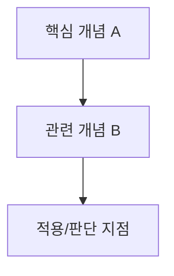

# {챕터 제목}

## 학습 목표

- 이 챕터를 통해 구분·설명·판단·적용할 수 있게 되는 것 3~5개.
- "완료한다"가 아니라 무엇을 할 수 있게 되는지 구체적으로 쓴다. 완료 기준처럼 쓰지 않는다.

## 다룰 개념과 용어

- 핵심 개념과 용어. 이름만 나열하지 말고 한 줄 설명을 붙인다.

## 개념 관계도

## 학습 흐름

- 개념 학습에서 다룰 것 (배치 진단 미확인 항목은 예측 질문으로 확인)
- 실습에서 확인할 것
- 시험에서 검증할 것

## 개념 파일

<!-- 개념 학습 때 concepts/NN-<slug>.md를 쓰고 여기에 링크한다. 예: - [3값 논리](concepts/01-three-valued-logic.md) -->
